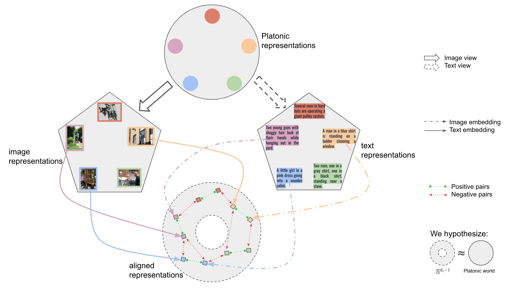
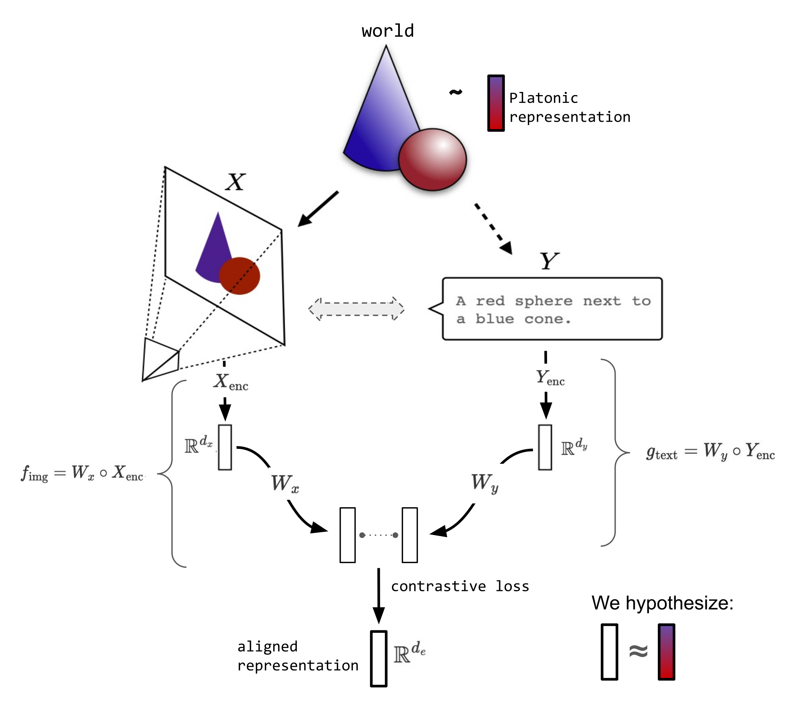
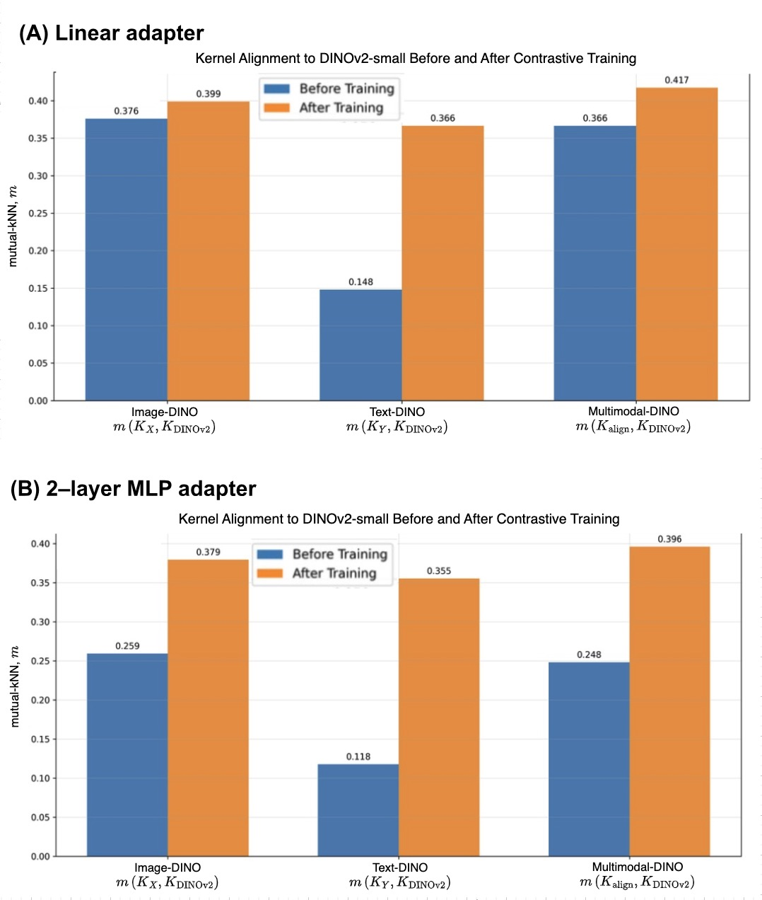
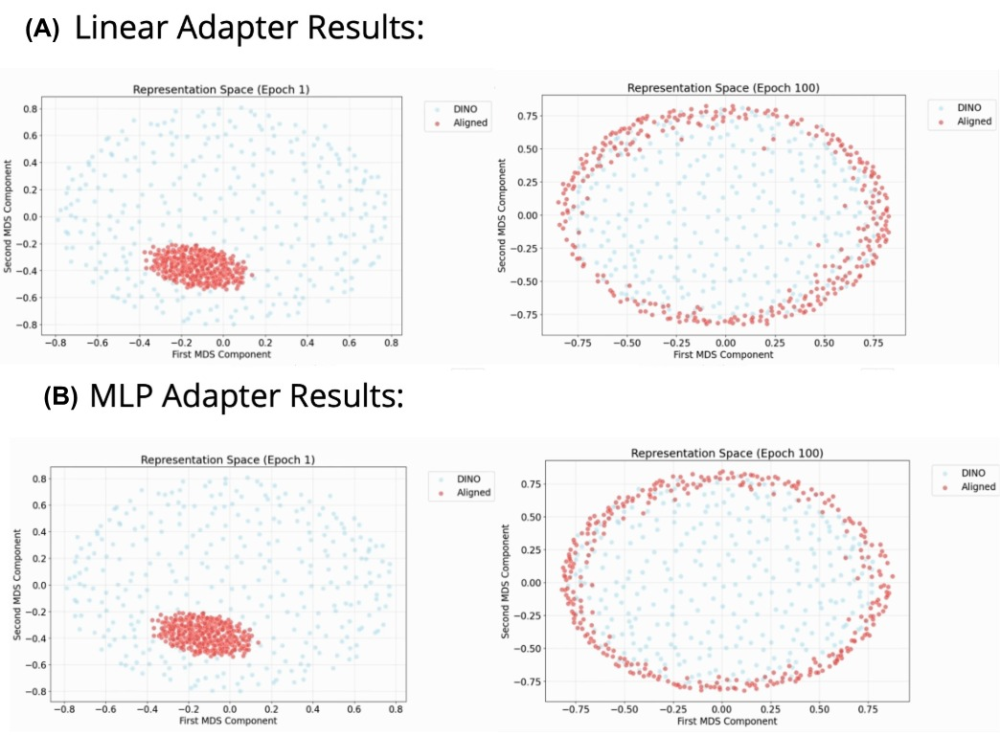
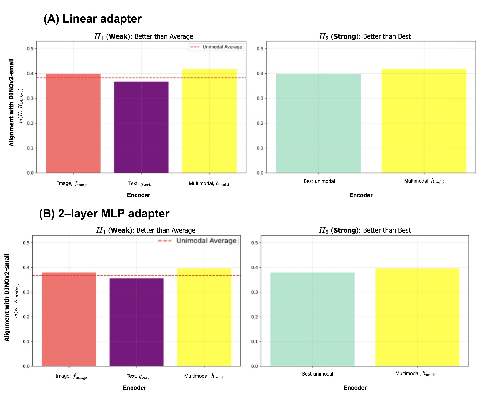

[Quilee Simeon](https://qsimeon.github.io/) | [MIT Deep Learning Final Project Blog](https://github.com/qsimeon/deep_learning_project) | December 2024

## Introduction

Deep learning models are usually trained to turn raw data into representations tuned for a specific task. Two recent lines of research raise a deeper question about the nature of those representations. The **CLIP framework** showed the value of aligning representations across modalities: it trains joint embeddings on paired image-text data so that one modality can be used to retrieve the other. The **Platonic Representation Hypothesis** proposes that performant models converge toward a shared statistical model of reality in their representation spaces, which hints at a universality underlying learned representations.

This project connects the two ideas. Following CLIP's joint-embedding approach and the convergence claim of the Platonic Representation Hypothesis, we ask whether representations from separate pre-trained unimodal neural networks can be aligned into a shared multimodal latent space. Our framework keeps the unimodal encoders frozen, ResNet-18 for images and DistilBERT for text, and learns simple linear adapters that map their outputs into the shared space. We then test whether the aligned representations better approximate those of larger, more performant models. The aim is to reach alignment without retraining a larger state-of-the-art model such as DINOv2, so that the approach can scale to new modalities with minimal overhead.

*Figure 1. Conceptual illustration of our multimodal alignment framework. Lightweight adapters align representations from ResNet-18 (images) and DistilBERT (text), computed on image-caption samples from the Flickr30k dataset, into a shared latent space. Matching image-caption pairs are pulled together and non-matching pairs are pushed apart, which produces a unified multimodal embedding.*

### Motivation

Three ideas motivate our approach:

1. **Inspiration from CLIP:** CLIP showed that paired data and contrastive learning can align cross-modal representations. Its joint training, however, limits how easily it scales to new modalities. Our method decouples the encoders and aligns their outputs through lightweight adapters.

2. **Testing the Platonic Representation Hypothesis:** This hypothesis holds that models converge toward a shared statistical model of reality. Aligning diverse unimodal encoders tests whether that convergence can be reached explicitly.

3. **Scalability and Modularity:** Because our framework aligns frozen encoders post hoc, it can integrate new modalities efficiently, without extensive joint training.

## Related Work

Our project builds on several important advances in multimodal representation learning and on theoretical work about model convergence:

1. **[Platonic Representation Hypothesis (PRH)](https://phillipi.github.io/prh/):** [Huh et al. (2024)](https://arxiv.org/abs/2405.07987) proposed that performant models converge toward a shared statistical model of reality in their representation spaces, whatever modality they were trained on. This hypothesis is the foundation of our framework, which aligns unimodal encoders explicitly to test it.

2. **[CLIP](https://openai.com/index/clip/):** [Radford et al. (2021)](https://arxiv.org/abs/2103.00020) introduced CLIP, a model that learns joint multimodal representations through contrastive learning on paired image-text datasets. CLIP's success shows the power of cross-modal embeddings, but CLIP requires its encoders to be trained jointly. Our framework is designed to avoid that requirement.

3. **Linear Mapping from Image to Text Space:** [Merullo et al. (2022)](https://arxiv.org/abs/2209.15162) showed that simple linear transformations can align visual representations to text spaces, enabling cross-modal tasks such as visual question answering. Their findings led us to use linear adapters and lightweight multilayer perceptron (MLP) adapters for multimodal alignment.

4. **DINOv2:** [Oquab et al. (2023)](https://arxiv.org/abs/2304.07193) introduced DINOv2, a self-supervised vision transformer that produces robust embeddings. We use DINOv2-small as our performant reference model, the benchmark for judging the quality of our aligned multimodal representations.

5. **Contrastive Representation Learning:** [Wang and Isola (2020)](https://arxiv.org/abs/2005.10242) analyzed contrastive learning in terms of alignment and uniformity on the hypersphere. Their work shows that contrastive objectives both align positive pairs and spread representations uniformly across the hypersphere. This analysis informs our use of the **dual-encoder contrastive loss** to drive convergence in the shared latent space.

## Hypothesis

Our work rests on the following hypotheses:

- A shared latent space exists in which linear transformations can align unimodal representations from different encoders.
- Aligning these representations produces embeddings that closely approximate those of performant models such as DINOv2, as measured by kernel alignment metrics.
- Multimodal alignment captures mechanisms of representation convergence, which provides empirical evidence for the Platonic Representation Hypothesis.

## Mathematical Framework

The central hypothesis of our project is that pre-trained unimodal representations can be aligned into a shared multimodal latent space. This section formalizes the mathematical structure of the framework: how representations are extracted, aligned and evaluated.

### Multimodal Data Representation

Let the world generate raw multimodal data:

$$\mathcal{D}_\text{world} = \left\{\left(\theta^{(i)}, \psi^{(i)}, \phi^{(i)}, \dots\right)\right\}_{i=1}^N, \quad \theta \in \mathcal{\Theta}, \psi \in \mathcal{\Psi}, \phi \in \mathcal{\Phi}, \dots$$

where $\mathcal{\Theta}, \mathcal{\Psi}, \mathcal{\Phi}$ are different modalities (e.g., image, text, audio) and $\theta, \psi, \phi$ are specific instances of them.

For simplicity, we focus on a setting with two modalities, images ($\mathcal{X}$) and text ($\mathcal{Y}$):

$$\mathcal{D}_\text{world} = \left\{\left(x^{(i)}, y^{(i)}\right)\right\}_{i=1}^N, \quad x \in \mathcal{X}, y \in \mathcal{Y}.$$

*Figure 2. Conceptual illustration of the connection between the Platonic Representation Hypothesis (PRH) and our framework. The PRH holds that representations from different modalities (e.g., images, text) converge toward a shared statistical model, the Platonic representation. Our framework uses contrastive learning to align these representations explicitly in a shared latent space, approximating this convergence.*

### Learned Adapters

We use frozen pre-trained encoders to extract representations:

$$X_\text{enc}: \mathcal{X} \rightarrow \mathbb{R}^{d_x}, \quad Y_\text{enc}: \mathcal{Y} \rightarrow \mathbb{R}^{d_y},$$

where $d_x$ and $d_y$ are the embedding dimensions for images and text, respectively. We use:

- **ResNet-18** trained on ImageNet1K for images ($d_x = 512$).
- **DistilBERT** trained on BookCorpus for text ($d_y = 768$).

To project these into a shared latent space $\mathbb{R}^{d_e}$, we introduce adapters:

$$W_x : \mathbb{R}^{d_x} \rightarrow \mathbb{R}^{d_e}, \quad W_y : \mathbb{R}^{d_y} \rightarrow \mathbb{R}^{d_e}.$$

The adapted encoders are:

$$f_\text{image}(x) = W_x \circ X_\text{enc}(x), \quad g_\text{text}(y) = W_y \circ Y_\text{enc}(y),$$

where $f_\text{image}$ and $g_\text{text}$ map images and text into the shared latent space $\mathbb{R}^{d_e}$.

### Dual-Encoder Contrastive Objective

To align the representations, we use a **dual-encoder contrastive loss** inspired by the coursework (see Homework 4). This loss makes positive pairs more similar and pushes negative pairs apart:

$$\mathcal{L}_{\text{contrastive}} = -\frac{1}{N} \sum_{i=1}^N \log \frac{\exp\left(f_\text{image}(x^{(i)}) \cdot g_\text{text}(y^{(i)}) / \tau\right)}{\sum_{j=1}^N \exp\left(f_\text{image}(x^{(i)}) \cdot g_\text{text}(y^{(j)}) / \tau\right)},$$

where $\tau$ is the temperature parameter, which controls the sharpness of the similarity scores.

Contrastive learning usually works with different "views" of samples from a *single modality*, generated through transformations or augmentations. We generalize this idea by treating *different modalities* (image and text) as distinct views of a **hypothesized common underlying reality**, following the Platonic Representation Hypothesis.

### Connection to the Platonic Representation Hypothesis

The **Platonic Representation Hypothesis (PRH)** holds that representations from different modalities converge toward a shared Platonic representation. In our framework, we hypothesize that **contrastive alignment** between the unimodal image and text encoders drives this convergence.

We define our aligned multimodal encoder as:

$$h_\text{multi}(x, y) = \lambda \cdot f_{\text{image}}(x) + (1 - \lambda) \cdot g_{\text{text}}(y),$$

where $\lambda$ is a learnable parameter that sets the balance between the two modalities.

### Performant Model Benchmark

We use the **DINOv2-small** encoder as a benchmark for the quality of our aligned multimodal representations. We write the function implemented by the DINOv2-small feature extractor as:

$$\text{DINOv2}: \mathcal{X} \rightarrow \mathbb{R}^{d_e}.$$

The DINOv2 encoder serves as a performant reference model that provides high-quality image representations. Comparing our aligned multimodal representations with the DINOv2 representations measures how closely our contrastive alignment approximates this benchmark.

### Kernel Alignment Metric

We describe representations by their **kernels**, which capture the similarity between data points. Two representations are **aligned** if their kernels are similar on corresponding inputs. Given the kernels:

- $K_X(i, j) = \langle f_{\text{image}}(x^{(i)}), f_{\text{image}}(x^{(j)}) \rangle$
- $K_Y(i, j) = \langle g_{\text{text}}(y^{(i)}), g_{\text{text}}(y^{(j)}) \rangle$
- $K_{\text{align}}(i, j) = \langle h_\text{multi}(x^{(i)}, y^{(i)}), h_\text{multi}(x^{(j)}, y^{(j)}) \rangle$
- $K_{\text{DINOv2}}(i, j) = \langle \text{DINOv2}(x^{(i)}), \text{DINOv2}(x^{(j)}) \rangle$

we evaluate alignment with the **mutual k-nearest-neighbor (mutual-KNN) kernel alignment metric** $m$.

Specifically, we compute the following values:

**Unimodal Alignment:**
- $m(K_X, K_{\text{DINOv2}})$: Alignment of the image encoder $f_\text{image}$ kernel with the DINOv2 kernel.
- $m(K_Y, K_{\text{DINOv2}})$: Alignment of the text encoder $g_\text{text}$ kernel with the DINOv2 kernel.

**Multimodal Alignment:**
- $m(K_{\text{align}}, K_{\text{DINOv2}})$: Alignment of the multimodal encoder $h_\text{multi}$ kernel with the DINOv2 kernel.

We conjecture that the aligned multimodal kernel will be more similar to $K_{\text{DINOv2}}$ than the unimodal kernels are.

## Methodology

All code for this project is in our [GitHub Repository](https://github.com/qsimeon/deep_learning_project).

### Data Pipeline

We use the first 12,800 samples of the **[Flickr30k](https://huggingface.co/datasets/nlphuji/flickr30k)** dataset, which contains paired image-caption samples. Each image is paired with its first caption to form a single positive pair $(x^{(i)}, y^{(i)})$.

**Image Processing:**
- Resize to 224x224.
- Normalize using ImageNet statistics.
- Convert to tensors for ResNet-18.

**Text Processing:**
- Tokenize with DistilBERT tokenizer.
- Pad/truncate to 64 tokens.
- Convert to tensors for DistilBERT.

**Data Loading:**
- Batch size: 256.
- Train-validation split: 75%-25%.

### Model Architecture

We pair frozen pre-trained encoders with trainable adapters that align their representations in a shared multimodal space:

**Frozen Encoders:**
- Image Encoder: ResNet-18 ($d_x = 512$).
- Text Encoder: DistilBERT ($d_y = 768$).

**Adapters:**
- Linear Adapter: Matrix multiplication by $W_x$ or $W_y$ plus bias term.
- MLP Adapter: 2-layer MLP with GELU and LayerNorm.

**Reference Model:** DINOv2-small ($d_e = 768$).

### Training Procedure

We train the adapters with the dual-encoder contrastive loss for **100 epochs** on Flickr30k, using a temperature of $\tau = 0.02$ in the contrastive loss. The other relevant hyperparameters are:

- **Optimizer:** AdamW
- **Learning Rate:** $1 \times 10^{-4}$ (cosine decay with warmup).
- **Gradient Clipping:** 0.5.
- **Weight Decay:** 0.001 (linear adapter) and 0.005 (MLP adapter).
- **Label Smoothing:** 0.05.
- **Dropout:** 0.1.

### Evaluation Metrics

We test **two key hypotheses**, using the mutual-kNN values described in the Mathematical Framework, before and after training:

- **Weak Hypothesis ($H_1$):** The aligned multimodal kernel achieves higher similarity with the DINOv2 kernel than the average of the unimodal kernels:
  $$m(K_{\text{align}}, K_{\text{DINOv2}}) > \text{avg}(m(K_X, K_{\text{DINOv2}}), m(K_Y, K_{\text{DINOv2}})).$$

- **Strong Hypothesis ($H_2$):** The aligned multimodal kernel surpasses even the best unimodal kernel:
  $$m(K_{\text{align}}, K_{\text{DINOv2}}) > \max(m(K_X, K_{\text{DINOv2}}), m(K_Y, K_{\text{DINOv2}})).$$

## Results

### Kernel Alignment Gains from Training

Our first key finding is that the **mutual-KNN kernel alignment metric** improves after training for both the linear and MLP adapters. Our contrastive alignment objective therefore aligns the image and text representations effectively.

*Figure 3. Bar plot of the mutual-KNN kernel alignment metric before and after training for the (A) linear and (B) 2-layer MLP adapters. For both adapter types and all encoders, kernel alignment to the DINOv2-small encoder improves after training with the dual-encoder contrastive objective.*

Before training, the alignment scores are relatively low, particularly for the text encoder. After training, alignment increases significantly for both the image and text encoders. The multimodal alignment scores exceed the individual unimodal scores, which suggests that the adapters bridge the gap between the modalities.

### Visualization of Alignment

To illustrate the alignment further, we use dimensionality reduction to visualize the embeddings from the DINOv2-small encoder and from our aligned multimodal encoder. Principal component analysis (PCA) shows the idea: we compute the principal components (PCs) of the DINOv2-small embeddings and project the multimodal embeddings onto the same PCs. Multidimensional scaling (MDS) is a similar technique, but nonlinear.

During training, the aligned multimodal embeddings move progressively closer to the DINOv2 embeddings. This supports the hypothesis that our contrastive objective aligns the representations effectively.

*Figure 4. MDS plots of the embeddings from the DINOv2-small encoder (blue) and our aligned multimodal encoder (yellow) at the first epoch (left) and last epoch (right) of training, for both adapter types: (A) linear and (B) MLP. The multimodal representations become progressively more aligned with the DINOv2 embeddings during training.*

### Support for the Key Hypotheses

Our results validate both the weak hypothesis ($H_1$) and the strong hypothesis ($H_2$):

- **Weak Hypothesis ($H_1$):** The aligned multimodal kernel achieves higher similarity with the DINOv2 kernel than the average of the unimodal kernels.
- **Strong Hypothesis ($H_2$):** The aligned multimodal kernel surpasses even the best unimodal kernel.

The multimodal representations, which combine image and text information, are therefore more closely aligned with the DINOv2 embeddings than either the image or the text representations alone.

*Figure 5. The mutual-KNN kernel alignment metric for our aligned multimodal encoder surpasses both the average (left) and the better (right) of the two unimodal encoders, supporting both the weak and strong hypotheses. Results are shown for (A) linear adapters and (B) 2-layer MLP adapters.*

The multimodal alignment scores consistently exceed the individual image and text alignment scores. This points to an emergent property in which the whole (the multimodal representation) is greater than the sum of its parts (the unimodal representations). The finding is particularly compelling because DINOv2 is a vision-only model trained without any text supervision.

Our results suggest that multimodal information improves the quality of the learned representations, which supports the **Platonic Representation Hypothesis**. That hypothesis posits a shared statistical model of reality underlying the different modalities. Because multimodal alignment produces representations closer to DINOv2, a high-performing vision model, the results reinforce the idea that such a shared model exists.

In summary, our findings show that aligning image and text representations with simple linear or MLP adapters can produce embeddings that outperform unimodal representations when compared with a performant model like DINOv2.

## Discussion

In this work, we investigated whether lightweight adapters can align representations from pre-trained unimodal encoders into a shared multimodal latent space. Our results support the **Platonic Representation Hypothesis (PRH)** proposed by Huh et al. (2024). Aligning image and text embeddings through contrastive learning produced multimodal representations that are more closely aligned with DINOv2-small features than unimodal representations alone.

The **CLIP framework** (Radford et al., 2021) aligns cross-modal representations through joint training. Our approach, inspired by CLIP, achieves alignment post hoc with frozen encoders and lightweight adapters, which offers a scalable alternative to joint training for multimodal learning.

### Key Insights

- **Cross-Modal Alignment:** **DINOv2-small** is a self-supervised vision model trained without text supervision, yet aligning image and text representations still made them more similar to DINOv2 embeddings. This suggests a universal structure in representation spaces and reinforces the PRH's idea of convergence toward a shared statistical model of reality.

- **Generalized Contrastive Views:** Our dual-encoder contrastive objective extends the usual notion of "views" in contrastive learning to distinct modalities, treating them as different perspectives on an underlying reality. This idea distinguishes our work from conventional contrastive learning.

- **Empirical Hypothesis Validation:** Our findings validate both the **weak** and **strong hypotheses**. Multimodal alignment yields representations that outperform unimodal representations when compared with DINOv2 embeddings.

### Non-Trivial Alignment to DINOv2

Our multimodal encoder was never explicitly optimized to match DINOv2-small embeddings. The aligned encoder $h_{\text{multi}}(x, y)$ still produces representations closer to DINOv2 than the image encoder alone does. That result indicates a genuine benefit of multimodal alignment that goes beyond replicating the image features.

### Potential Limitations

- **Dataset Bias:** The **Flickr30k** dataset mostly shows people in everyday situations. This limited diversity may affect how well our findings generalize. Exploring more diverse datasets could offer further insights.

- **Restricted Modalities:** Our study focused on image and text alignment. Extending the framework to more modalities, such as audio or video, could validate the alignment mechanism and the PRH more broadly.

### Conclusion

Our work shows that multimodal alignment through contrastive learning is a promising approach to efficient, scalable representation learning. The convergence we observed toward DINOv2 embeddings supports the idea of a **universal Platonic representation**, in which aligning multiple modalities reveals shared underlying structure in representation spaces. Building on insights from both the **CLIP framework** and the **Platonic Representation Hypothesis**, this result underscores the potential of multimodal alignment to advance our understanding of representation learning.

## Future Directions

### 1. Leveraging Multiple Captions for Alignment

This work used only the first Flickr30k caption for each image. To improve alignment, we plan to use all five captions per image. Each data point $i$ will be represented as $(x^{(i)}, y_1^{(i)}, \dots, y_5^{(i)})$, where $y_k^{(i)}$ is the $k$-th caption. The contrastive loss becomes:

$$\mathcal{L}_{\text{multi-caption}} = -\frac{1}{N} \sum_{i=1}^N \log \frac{\exp\left(\frac{1}{5\tau} \sum_{k=1}^5 f_\text{image}(x^{(i)}) \cdot g_\text{text}(y_k^{(i)})\right)} {\sum_{j=1}^N \exp\left(\frac{1}{5\tau} \sum_{k=1}^5 f_\text{image}(x^{(i)}) \cdot g_\text{text}(y_k^{(j)})\right)}.$$

### 2. Scaling to Richer Multimodal Datasets

We aim to extend our experiments to a third modality, such as audio. For example, with the **[VGGSound](https://www.robots.ox.ac.uk/~vgg/data/vggsound/)** dataset and a pre-trained audio encoder like **[Wav2Vec](https://huggingface.co/docs/transformers/en/model_doc/wav2vec2)**, we can test whether adding audio improves alignment over the image-text setting.

We will also generalize the dual-encoder loss to a **multi-encoder contrastive loss** for $M$ modalities:

$$\mathcal{L}_{\text{multi-encoder}} = -\frac{1}{N} \sum_{i=1}^N \log \frac{\exp\left(\sum_k \prod_{m=1}^M (f_m^{(i)})_k / \tau\right)} {\sum_{j=1}^N \exp\left(\sum_k \prod_{m=1}^M (f_m^{(j)})_k / \tau\right)}.$$

### 3. Zero-Shot Evaluation with Pre-Trained Heads

We plan to evaluate the quality of our aligned representations with the pre-trained classifier heads from the [DINOv2 GitHub repository](https://github.com/facebookresearch/dinov2?tab=readme-ov-file). We will replace the DINOv2-small encoder with our aligned multimodal encoder $h_\text{multi}$ and test zero-shot classification performance on ImageNet.
