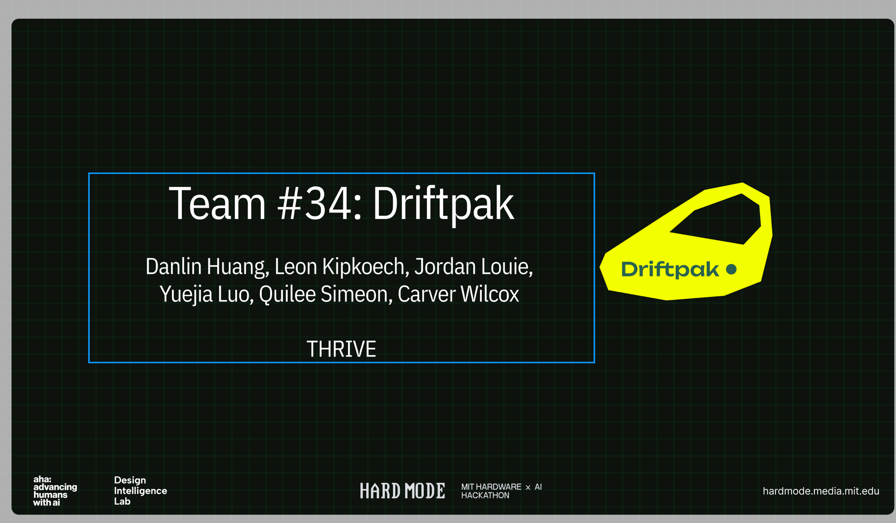
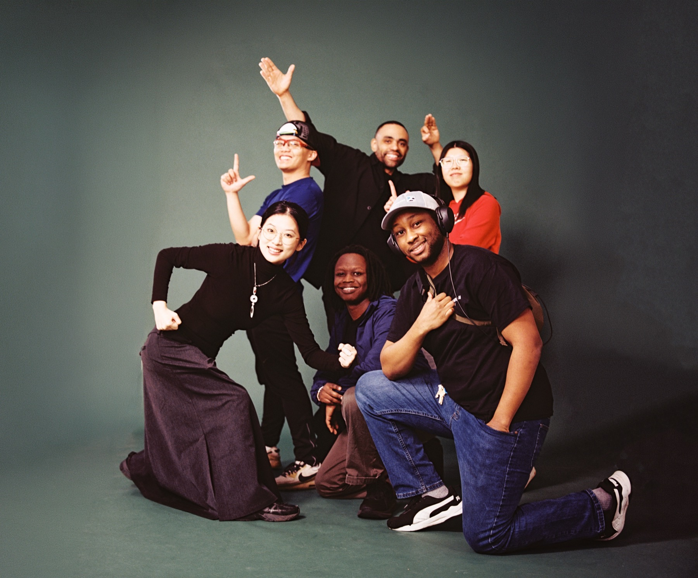
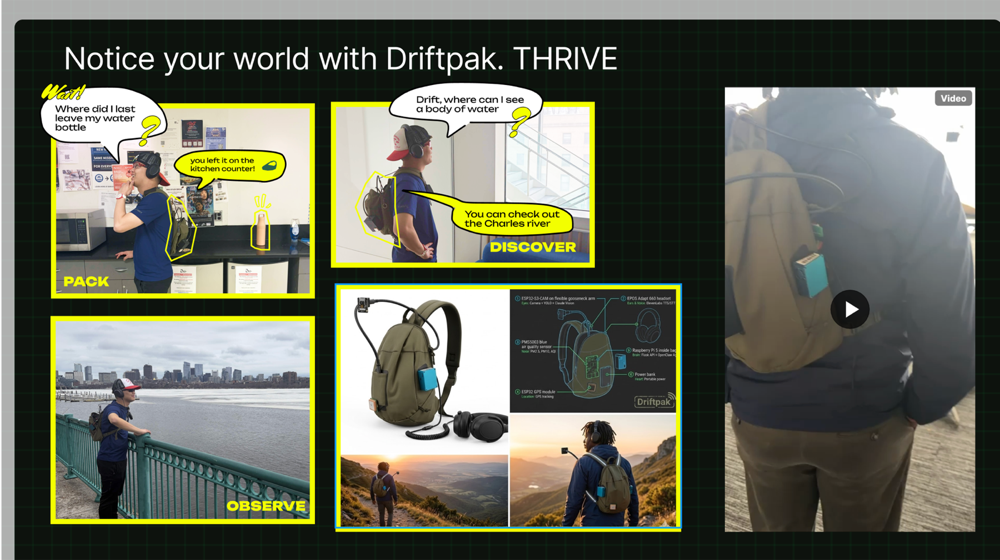

Do you guys remember Dora the Explorer's backpack? The one that always had exactly what she needed, spoke when spoken to, and was somehow aware of what was going on?

That's what we were building.

At [HardMode 2026](https://hardmode.media.mit.edu), a 24-hour hackathon at the MIT Media Lab themed around *THRIVE*, our team built **DriftPak**. It is a Raspberry Pi-powered backpack that can see the world through a camera, speak through a headset, know where it is via GPS and sense air quality. An AI agent reachable on Telegram coordinates all of it.

This post covers how we built it, what worked and where the real difficulties were.

---

## The Team





Team #34 (**Driftpak**):
- **Danlin Huang**
- **Leon Kipkoech**: ESP32 hardware, Flask server, firmware architecture
- **Jordan Louie**
- **Yuejia Luo**
- **Quilee Simeon** (me): Raspberry Pi, OpenClaw agent, system integration
- **Carver Wilcox**

The hackathon was sponsored by [MBZUAI's Institute of Foundation Models](https://ifm.mbzuai.ac.ae/), which offered a special track for the best use of their K2 Think V2 open reasoning model.

---

## The Concept



We gave our trail-companion bag three jobs.

**PACK**: look inside itself with the camera, cross-reference the weather and the planned route, and alert you if you've forgotten something. The demo scenario on our slide was literal: *"Where did I last leave my water bottle?"* → *"You left it on the kitchen counter!"*

**DISCOVER**: answer questions about your surroundings in real time. *"Drift, where can I see a body of water?"* → *"You can check out the Charles River."*

**OBSERVE**: monitor air quality, temperature and humidity throughout the adventure, and surface useful environmental data without pulling you out of the present moment.

We also wanted the bag to be more than a gadget, with a personality of its own. We wrote out the agent's identity explicitly before writing a line of code:

> *Warm, encouraging, slightly protective, curious about the world. Think Dora the Explorer's Backpack meets a park ranger meets a mindfulness coach.*

---

## The Architecture

The system has three layers.

```
Telegram / Voice
        ↕
  OpenClaw Agent (Pi :18789)
        ↕  HTTP
  Flask API Server (Pi :5000)
        ↕  proxy
  ESP32 Devices (192.168.137.x)
  ├── ESP32-S3-CAM (.140)  — camera + LED strip
  ├── ESP32 WROOM-32 (.28) — Neo-6M GPS
  └── ESP32 + PMS5003 (.115) — air quality (PM2.5/PM10/AQI)
  + EPOS Adapt 660 (USB-C)  — microphone + speaker
```

**Flask** acts as the "nervous system." Its 18 REST endpoints abstract the ESP32 microcontrollers and the rest of the hardware completely. The agent reaches every ESP32 through HTTP calls to `localhost:5000`. As a result, we could develop and debug the AI layer and the hardware layer independently. When something broke, you knew which layer to blame.

**OpenClaw** is an open-source local AI agent framework that runs on the Pi and connects to a language model of your choice. We configured it with 16 curl-based tools that wrap the Flask endpoints, including `take_photo`, `say`, `listen`, `get_gps`, `led_on` and `check_devices`. OpenClaw handles the reasoning loop, while the tools give it hands.

**The ESP32 auto-discovery protocol** was one of Leon's elegant ideas. Any ESP32 that serves a `/docs` endpoint in a specific JSON format gets registered automatically, proxy routes are created for all of its endpoints, and the agent gains access immediately. When you plug in a new sensor, it integrates itself.

---

## Vision in Two Tiers

The bag's eyes use a tiered approach that we're particularly happy with.

**Tier 1 is YOLO** (You Only Look Once), which runs locally on the Pi using YOLOv8 nano (~6MB). It is fast (~50ms) and works offline. Its 80 standard COCO (Common Objects in Context) classes, such as person, backpack, bottle, phone and dog, are enough for quick detection.

**Tier 2 is Claude Vision**, which takes over when you need more. It receives the same image with YOLO's results as context and can identify anything YOLO can't: brands on labels, handwritten text, trail markers, specific plant species and obscure gear.

```python
# vision_manager.py — the key pattern
yolo_result = self.detect(image_bytes)       # fast, offline
# pass YOLO findings as context to Claude
claude_response = self.claude.messages.create(
    model="claude-sonnet-4-20250514",
    messages=[{
        "role": "user",
        "content": [
            {"type": "image", "source": {"type": "base64", "data": img_b64}},
            {"type": "text", "text": f"What do you see? YOLO detected: {yolo_summary}"}
        ]
    }]
)
```

Each tier answers its own question. YOLO answers "what's here, fast." Claude answers "what does it mean."

---

## The Build

We started from zero, with a fresh Pi board that had no OS.

The first two hours went to OS setup and networking. MIT's enterprise WiFi (WPA2 Enterprise) can't be pre-configured in the Pi Imager, so you have to connect manually on first boot. Once we were on MIT SECURE, the next hurdle was the subnets. The ESP32s expected to live on `192.168.137.x` (Leon's laptop hotspot subnet), while the Pi was on `10.31.x.x`. Our solution was to make the Pi broadcast its own WiFi hotspot for the ESP32s while it stayed connected to MIT SECURE for internet. This setup is concurrent AP+STA mode (access point plus client station) on the Pi's onboard WiFi chip.

Installing OpenClaw had its own quirks. The npm global bin path wasn't in the Pi's `PATH` out of the box, which made the systemd service registration fail in a confusing way. Once we traced the cause and added `~/.npm-global/bin` to `.bashrc`, the gateway came up clean.

The most load-bearing moment of the hack was finding and fixing a one-line, Windows-only bug in the audio code:

```python
# what it was (developed on Windows)
os.system(f'start /min "" "{tmp_path}"')

# what it needed to be on Pi Linux
os.system(f'mpg123 -q "{tmp_path}" &')
```

The fix took a single line, since everything else was already correct. ElevenLabs text-to-speech (TTS) was wired up, so the audio only needed to actually play through the speaker.

By hour 18, all three ESP32s were online, the Flask server was running 18 endpoints behind a live dashboard accessible over Tailscale, and the OpenClaw agent was responding to messages in our Telegram group.

---

## The Demo System

| Component | Status at Demo |
|-----------|---------------|
| Flask API server (18 endpoints) | ✅ Running, systemd autostart |
| OpenClaw agent (16 tools) | ✅ Telegram active |
| Live monitoring dashboard | ✅ Accessible via Tailscale |
| ESP32 camera | ✅ Online |
| ESP32 GPS | ✅ Online (no satellite fix indoors) |
| Air quality sensor | ✅ Online |
| ElevenLabs TTS (Sarah voice) | ✅ Working |
| YOLOv8 object detection | ✅ Running on Pi |
| Claude Vision identification | ✅ Integrated |
| Continuous audio transcription | ✅ Rolling 50-transcript buffer |

The bag survived a power bank swap mid-demo because we had set up systemd user services with lingering. Both Flask and OpenClaw restart automatically on boot without anyone logged in.

---

## Design Decisions Worth Keeping

**Flask as middleware is the right abstraction for hardware plus AI.** The agent should not have to speak the I2C bus protocol or parse the NMEA sentences a GPS module emits. It only needs `GET /gps` to return `{"lat": 42.36, "lng": -71.09}`. The middleware handles everything in between, so the agent can be swapped out independently of the hardware layer.

**Auto-discovery through `/docs` contracts beats hardcoding.** Any ESP32 that serves a structured `/docs` endpoint is integrated without anyone touching the Flask server. We added the air quality sensor mid-hack in under 10 minutes.

**SSH ControlMaster saves sanity when scripting.** A script that makes three SSH connections (mkdir, scp, resolve path) normally means three password prompts. ControlMaster reuses one socket, which brings that down to a single prompt. It is a small thing that made a large quality-of-life difference over 24 hours.

**YOLOv8 nano plus Claude Vision is a better duo than either alone.** YOLO is fast but limited to 80 COCO classes. Claude is comprehensive but costs a round trip. Run YOLO first and pass its findings to Claude as context. Claude's response is then more grounded, because you are no longer asking it to describe the whole image cold.

---

## Takeaways

**The agent identity doc matters more than you think.** Writing out who the bag *is* (its voice, its three missions, its personality) before writing a line of code gave the whole project a coherence it would otherwise have lacked. When we were making design calls at hour 14, we kept asking "what would Driftpak do?" and getting useful answers.

**The middleware pattern scales.** One Flask server feeds one agent. Adding a new sensor means adding one line to the auto-discovery registry, after which the agent's tool list grows automatically. This pattern generalizes to any hardware-AI integration where you want to swap out the reasoning layer without rewiring the hardware.

**Hackathon software is 80% plumbing.** The "AI" parts (the vision pipeline, the agent and the voice) took maybe four hours in total. The rest was OS setup, networking, systemd, PATH issues, a Windows bug and SSH keys. If you want to ship hardware plus AI in 24 hours, get the plumbing done first.

**Personal touch compounds.** "Dora the Explorer's Backpack meets a park ranger meets a mindfulness coach" is a sillier brief than most people would write. It is also the reason the agent has a consistent personality and the reason the project was fun to build. The best hackathon projects have a soul.

---

Code: [github.com/leonkoech/hackbag](https://github.com/leonkoech/hackbag)

---

*Built at HardMode 2026, MIT Media Lab, by Team #34 Driftpak: Danlin Huang, Leon Kipkoech, Jordan Louie, Yuejia Luo, Quilee Simeon, Carver Wilcox.*
