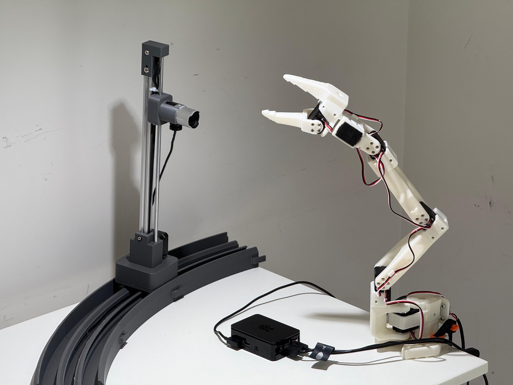

Octopus turns the hardware plugged into a computer into tools an AI agent can call. You run one install command on a Raspberry Pi or a Mac. A coding agent reads five markdown specifications, probes the USB, serial, I²C and GPIO ports, looks up datasheets for the devices it finds, and writes a Model Context Protocol (MCP) server for that exact machine. On our reference rig, the arm and both cameras became typed tools that any agent can call about 25 minutes after the install command.

The idea underneath is that the coding agent is the software. Instead of drivers, we ship specifications that the agent on each machine turns into platform-specific code.

*The reference rig: an SO-ARM101 arm, a LifeCam Studio and a Brio 100 camera, and a Raspberry Pi 4. Octopus discovered and served every device without any hand-written hardware code.*

I built Octopus with Yile Fan and Minggan (Justin) Wei for MIT MAS.664 (AI Studio) in spring 2026. The paper, [Octopus Protocol](https://arxiv.org/abs/2605.09055), is accepted at the NeurIPS 2026 Workshop on Agentic Web.

**[Read the full post](https://qsimeon.github.io/octopus-hw/blog/)** for the diagrams and the install walkthrough. The project also has a [live demo site](https://qsimeon.github.io/octopus-hw/) and [code on GitHub](https://github.com/qsimeon/octopus-hw).
